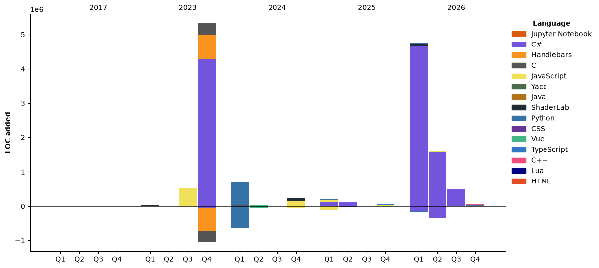

<h1 align="center">Hi 👋, I'm Richard Qu</h1>
<h3 align="center">Duke GDDI Master's Student | NYU CS Major + Game Design & Japanese Minor</h3>
<h3 align="center">😄 Pronouns: He/Him</h3>

<p align="center">
  <a href="https://www.kingslayerrq.fyi" target="_blank"><strong>Portfolio</strong></a> •
  <a href="mailto:rq2014@nyu.edu"><strong>Email</strong></a> •
  <a href="https://discord.gg/AYghsyBX" target="_blank"><strong>Discord</strong></a>
</p>

<p align="center">
  <a href="https://github.com/ryo-ma/github-profile-trophy">
    
  </a>
</p>

---

## 🎮 About Me

I'm a game developer and full-stack engineer currently pursuing a **Master's degree in Game Design, Development & Innovation (GDDI)** at Duke University. With a foundation in **Computer Science from NYU** and minors in **Game Design & Japanese**, I bring a unique blend of technical depth and creative vision to every project.

I'm passionate about **AI/ML**, **game development**, **interactive storytelling**, and **building tools** that solve real problems. I love working on diverse projects—from AI agents in Minecraft to full game clones to Discord utilities.

### 📚 Education
- 🎓 **Duke University** - Master's in Game Design, Development & Innovation (GDDI) *(Current)*
- 🎓 **NYU** - B.S. Computer Science Major + Game Design & Japanese Minors

### 💼 Current Focus
- 🔭 Working on **advanced game systems, AI integration, and interactive narratives**
- 🌱 Deepening knowledge in **game engine architecture, narrative design, and AI in games**
- 👯 Open to collaborating on **game dev, AI/ML, and full-stack projects**
- 🤝 Looking for help with **optimization, system design, and innovative gameplay mechanics**
- 💬 Ask me about **game development, Python AI, JavaScript/TypeScript, C#, game design theory, Japanese culture**
- 📫 Reach me at **rq2014@nyu.edu**
- ⚡ **Fun fact**: I solve complex problems by day and explore new games by night—hiking on weekends!

---

## 🎯 Featured Projects

### 🤖 AI & Machine Learning
- **[mindcraft](https://github.com/kingslayerrq/mindcraft)** - Minecraft AI with LLMs + Mineflayer
- **[AI-RL](https://github.com/kingslayerrq/AI-RL)** - Reinforcement Learning projects
- **[balatro-ai](https://github.com/kingslayerrq/balatro-ai)** - AI agent for Balatro card game
- **[pensieve_ai](https://github.com/kingslayerrq/pensieve_ai)** - Passive recording + indexing screenshots locally
- **[Credit-Card-Fraud-Detection](https://github.com/kingslayerrq/Credit-Card-Fraud-Detection-Project)** - ML fraud detection model
- **[AI-search](https://github.com/kingslayerrq/AI-search)** - Intelligent search implementation

### 🎮 Game Development
- **[Balatro-Clone](https://github.com/kingslayerrq/Balatro-Clone)** - Full C# clone of the hit poker roguelike
- **[GGJ2026](https://github.com/kingslayerrq/GGJ2026)** - Global Game Jam 2026 entry (Unity 6.3 LTS)
- **[Booomjam2026](https://github.com/kingslayerrq/Booomjam2026)** - Game jam project in C#
- **[Ecosystem](https://github.com/kingslayerrq/Ecosystem)** - Simulation/ecosystem game
- **[Froglid](https://github.com/kingslayerrq/Froglid)** - Game development project
- **[IntermediateGameDevFinal](https://github.com/kingslayerrq/IntermediateGameDevFinal)** - Advanced game dev coursework

### 💻 Full-Stack & Web
- **[my-web](https://github.com/kingslayerrq/my-web)** - Personal portfolio/website ([kingslayerrq.fyi](https://www.kingslayerrq.fyi))
- **[chatdemo](https://github.com/kingslayerrq/chatdemo)** - Interactive chat application
- **[react-login](https://github.com/kingslayerrq/react-login)** - Authentication system
- **[openjetlag](https://github.com/kingslayerrq/openjetlag.github.io)** - Jetlag Calculator (Vue.js)

### 🛠️ Tools & Utilities
- **[discord-last-login](https://github.com/kingslayerrq/discord-last-login)** - BetterDiscord plugin tracking last online
- **[NetEase-Cloud-Music-DiscordRPC](https://github.com/kingslayerrq/NetEase-Cloud-Music-DiscordRPC)** - Discord Rich Presence for music
- **[LeetHub](https://github.com/kingslayerrq/LeetHub)** - Sync LeetCode solutions to GitHub

---

## 💻 Languages & Tools

```
Primary Languages:    C# | JavaScript/TypeScript | Python | C
Game Development:     Unity | Unreal Engine | ShaderLab | C#
Web Development:      React | Vue.js | Node.js | TypeScript
AI/ML:               Python | Reinforcement Learning | LLMs
Narrative & Design:   Twine | Ink | Game Design Documentation
Databases:           SQL | Firebase
Tools & Platforms:   Git | Docker | AWS | VS Code
```

---

## 📊 GitHub Statistics

<div align="center">
  <a href="https://github.com/anuraghazra/github-readme-stats">
    
  </a>
  <a href="https://github.com/anuraghazra/github-readme-stats">
    
  </a>
</div>

<p align="center">
  
</p>

---

## 🎨 Contribution Visualization

<picture>
  <source media="(prefers-color-scheme: dark)" srcset="https://raw.githubusercontent.com/platane/platane/output/github-contribution-grid-snake-dark.svg">
  <source media="(prefers-color-scheme: light)" srcset="https://raw.githubusercontent.com/platane/platane/output/github-contribution-grid-snake.svg">
  
</picture>

---

## 📈 Coding Activity

<!--START_SECTION:waka-->


**🐱 My GitHub Data** 

> 📦 781.8 kB Used in GitHub's Storage 
 > 
> 🏆 527 Contributions in the Year 2026
 > 
> 💼 Opted to Hire
 > 
> 📜 35 Public Repositories 
 > 
> 🔑 29 Private Repositories 
 > 
**I'm an Early 🐤** 

```text
🌞 Morning                637 commits         ██████░░░░░░░░░░░░░░░░░░░   24.14 % 
🌆 Daytime                850 commits         ████████░░░░░░░░░░░░░░░░░   32.21 % 
🌃 Evening                918 commits         █████████░░░░░░░░░░░░░░░░   34.79 % 
🌙 Night                  234 commits         ██░░░░░░░░░░░░░░░░░░░░░░░   08.87 % 
```
📅 **I'm Most Productive on Monday** 

```text
Monday                   611 commits         ██████░░░░░░░░░░░░░░░░░░░   23.15 % 
Tuesday                  343 commits         ███░░░░░░░░░░░░░░░░░░░░░░   13.00 % 
Wednesday                316 commits         ███░░░░░░░░░░░░░░░░░░░░░░   11.97 % 
Thursday                 358 commits         ███░░░░░░░░░░░░░░░░░░░░░░   13.57 % 
Friday                   303 commits         ███░░░░░░░░░░░░░░░░░░░░░░   11.48 % 
Saturday                 249 commits         ██░░░░░░░░░░░░░░░░░░░░░░░   09.44 % 
Sunday                   459 commits         ████░░░░░░░░░░░░░░░░░░░░░   17.39 % 
```


📊 **This Week I Spent My Time On** 

```text
🕑︎ Time Zone: America/New_York

💬 Programming Languages: 
Python                   5 hrs 6 mins        ████████░░░░░░░░░░░░░░░░░   31.07 % 
JavaScript               3 hrs 32 mins       █████░░░░░░░░░░░░░░░░░░░░   21.54 % 
Bash                     2 hrs 56 mins       ████░░░░░░░░░░░░░░░░░░░░░   17.86 % 
Markdown                 2 hrs 2 mins        ███░░░░░░░░░░░░░░░░░░░░░░   12.42 % 
C++                      1 hr 10 mins        ██░░░░░░░░░░░░░░░░░░░░░░░   07.11 % 

🔥 Editors: 
VS Code                  12 hrs              ██████████████████░░░░░░░   72.98 % 
Codex Vscode             4 hrs 26 mins       ███████░░░░░░░░░░░░░░░░░░   27.02 % 

🐱‍💻 Projects: 
Heritage                 14 hrs 17 mins      ██████████████████████░░░   86.87 % 
rq23-assignments         1 hr 15 mins        ██░░░░░░░░░░░░░░░░░░░░░░░   07.67 % 
LightingAssignment       53 mins             █░░░░░░░░░░░░░░░░░░░░░░░░   05.47 % 

💻 Operating System: 
Windows                  16 hrs 27 mins      █████████████████████████   100.00 % 
```

🤖 **AI Coding This Week** 

```text
⏱ AI Coding Time: 13 hrs 56 mins (84.71%)

✍️ 10,122 lines written by AI, 471 lines written by hand (95.55% AI-written)

🔤 3,587,441 Input Tokens, 804,465 Output Tokens

💵 $230.72 Estimated AI Cost This Week

🧠 7 AI Sessions, 123 AI Prompts

GPT                      10,128 lines        █████████████████████████   100.00 % 

🔎 AI Coding Insights:
🤖 AI-Driven — 95.55% of written lines came from AI
📄 Detailed Prompter — average 557 characters per prompt
🔁 Iterative Prompter — average 18 prompts per session
🚀 High AI Trust — 4.84% of changed lines were hand-edited
```

**I Mostly Code in C#** 

```text
C#                       13 repos            ██████░░░░░░░░░░░░░░░░░░░   23.21 % 
Python                   12 repos            █████░░░░░░░░░░░░░░░░░░░░   21.43 % 
C++                      2 repos             █░░░░░░░░░░░░░░░░░░░░░░░░   03.57 % 
HTML                     1 repo              ░░░░░░░░░░░░░░░░░░░░░░░░░   01.79 % 
Lua                      1 repo              ░░░░░░░░░░░░░░░░░░░░░░░░░   01.79 % 
```


**Timeline**




 Last Updated on 03/11/2026 19:29:31 UTC
<!--END_SECTION:waka-->

---

## 🔗 Connect With Me

<p align="left">
  <a href="https://www.kingslayerrq.fyi" target="_blank" rel="noopener noreferrer">
    
  </a>
  <a href="https://discord.gg/AYghsyBX" target="_blank" rel="noopener noreferrer">
    
  </a>
  <a href="mailto:rq2014@nyu.edu" target="_blank" rel="noopener noreferrer">
    
  </a>
</p>

---

<p align="center">
  <em>⭐ If you find any of my projects interesting, feel free to star them and reach out!</em>
</p>
